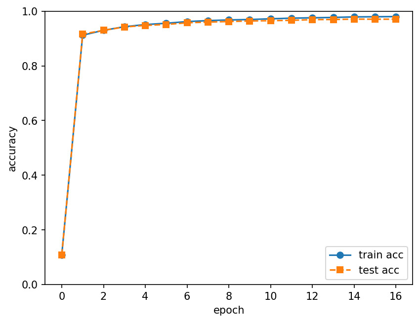
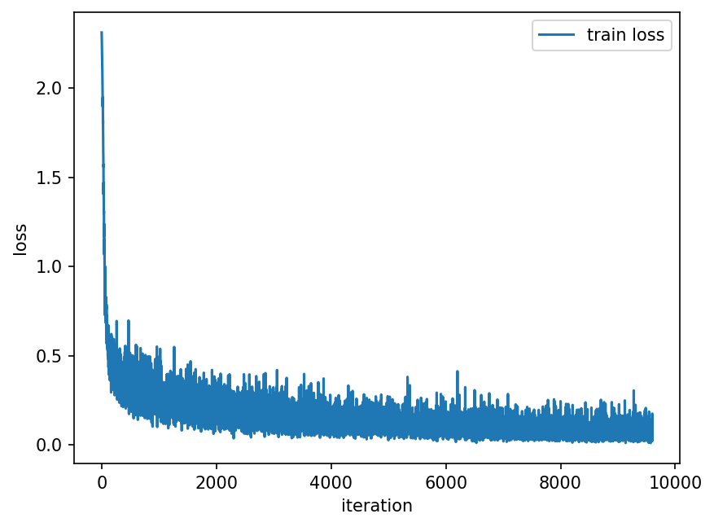

# dl-from-scratch

「밑바닥부터 시작하는 딥러닝」 1–5장을 NumPy로 직접 구현하고, 같은 2층 신경망을 PyTorch로 다시 구현해 결과를 비교한 학습 기록입니다.

## 폴더 구성

| 폴더 | 내용 |
| --- | --- |
| [ch01~ch05/](ch01~ch05/) | 책 1–5장 NumPy 구현 |
| [pytorch/](pytorch/) | 5장 2층 신경망의 PyTorch 구현 |
| [pytorch_study/](pytorch_study/) | PyTorch 기초 연습 (Tensor, Dataset, nn.Module) |
| [results/](results/) | 학습 결과 그래프 |

## 장별 구현 내용 (NumPy)

| 장 | 폴더 | 구현 내용 |
| --- | --- | --- |
| 3장 | [ch03/](ch01~ch05/ch03/) | 활성화 함수(계단, 시그모이드, 소프트맥스)와 사전 학습된 가중치로 MNIST 순전파 추론 |
| 4장 | [ch04/](ch01~ch05/ch04/) | 손실 함수와 수치 미분으로 기울기를 구해 2층 신경망을 미니배치 학습 |
| 5장 | [ch05/](ch01~ch05/ch05/) | Affine·ReLU·Softmax-with-Loss 계층을 구현하고 오차역전파법으로 2층 신경망 학습 |

## 결과: NumPy vs PyTorch

5장 2층 신경망(784 → 50 → 10, 배치 100, 학습률 0.1, SGD, 약 16 epoch)을 NumPy와 PyTorch로 각각 학습한 결과입니다. NumPy 버전은 역전파를 계층별로 직접 구현했고, PyTorch 버전은 같은 구조를 `nn.Module`과 autograd로 구현했습니다.

| | 최종 훈련 정확도 | 최종 테스트 정확도 |
| --- | --- | --- |
| NumPy (직접 구현한 역전파) | 97.97% | **97.03%** |
| PyTorch (autograd) | 98.03% | **97.07%** |

두 구현의 정확도와 학습 곡선이 거의 같아, 직접 구현한 역전파가 올바르게 동작함을 확인했습니다. (가중치 초기화 방식과 배치 샘플링 방식이 조금 달라 소수점 아래 차이가 있습니다.)

| | 정확도 | 손실 |
| --- | --- | --- |
| NumPy |  |  |
| PyTorch |  |  |

## 실행 방법

```bash
conda activate dl

# NumPy 버전
python ch01~ch05/ch05/train_neuralnet.py

# PyTorch 버전 (MNIST는 data/에 자동 다운로드)
python pytorch/Twolayer_torch.py
```

epoch마다 훈련/테스트 정확도가 출력되고, 학습이 끝나면 그래프가 `results/`에 PNG로 저장됩니다.

## 출처

[ch01~ch05/dataset/mnist.py](ch01~ch05/dataset/mnist.py)는 책의 공식 저장소 [WegraLee/deep-learning-from-scratch](https://github.com/WegraLee/deep-learning-from-scratch)에서 가져온 코드입니다.
