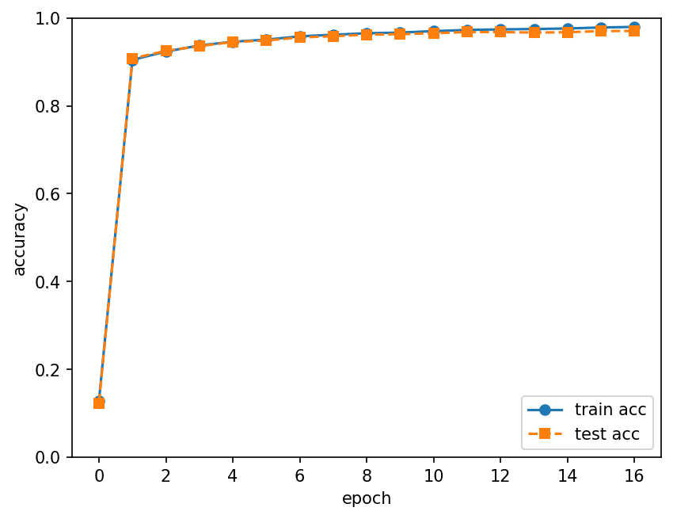
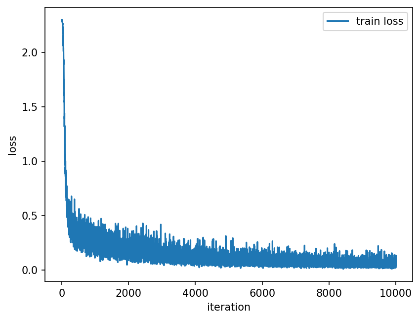

# dl-from-scratch

「밑바닥부터 시작하는 딥러닝」 1–5장을 NumPy로 직접 구현한 학습 기록입니다.

## 장별 구현 내용

| 장 | 폴더 | 구현 내용 |
| --- | --- | --- |
| 3장 | [ch03/](ch03/) | 활성화 함수(계단, 시그모이드, 소프트맥스)와 사전 학습된 가중치로 MNIST 순전파 추론 |
| 4장 | [ch04/](ch04/) | 손실 함수와 수치 미분으로 기울기를 구해 2층 신경망을 미니배치 학습 |
| 5장 | [ch05/](ch05/) | Affine·ReLU·Softmax-with-Loss 계층을 구현하고 오차역전파법으로 2층 신경망 학습 |

## 결과

5장 2층 신경망(은닉층 50, 배치 100, 학습률 0.1, 10,000 iteration = 약 16 epoch)으로 MNIST를 학습한 결과입니다.

| | 정확도 |
| --- | --- |
| 최종 훈련 정확도 | 97.97% |
| **최종 테스트 정확도** | **97.03%** |





## 실행 방법

```bash
conda activate dl
python ch05/train_neuralnet.py
```

epoch마다 훈련/테스트 정확도가 출력되고, 학습이 끝나면 그래프가 `results/`에 PNG로 저장됩니다.

## 출처

[dataset/mnist.py](dataset/mnist.py)는 책의 공식 저장소 [WegraLee/deep-learning-from-scratch](https://github.com/WegraLee/deep-learning-from-scratch)에서 가져온 코드입니다.
